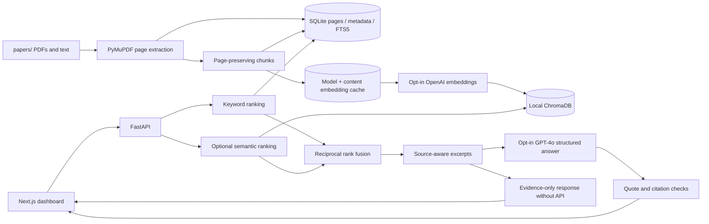

# Architecture

The application runs locally in two processes. Next.js serves the dashboard and proxies same-origin `/api/*` requests to FastAPI. FastAPI owns all filesystem, database, and provider operations. Browser code never receives provider keys.

## Persistence and identity

`data/corpus.sqlite3` stores documents, file aliases/statuses, page text, chunks, metadata, FTS5 rows, usage, discovery records, and caches. Connections use context managers and commit or roll back operations. WAL supports local read concurrency. Chroma uses `data/chroma/` and a collection named from the configured embedding model; embedding functions are explicitly disabled so Chroma never downloads a default model.

Document identity is the first 24 hexadecimal characters of the file SHA-256. Full hashes are retained for duplicate comparison. Chunk identity is a SHA-256 over pipeline version, document ID, page, offset, and exact normalized text. A changed PDF gets a new identity; existing citations then require the original corpus snapshot. Retain snapshots for long-term reproducibility.

Byte-identical PDF copies are tracked as file aliases and indexed once. DOI is normalized for discovery deduplication against the corpus. Different-byte revisions of a publication are retained as separate provenance-bearing documents; a DOI alone cannot establish identical page content. Potential same-DOI versions are reported in the inventory rather than silently merging incompatible page citations.

Re-ingestion re-extracts locally and updates SQLite transactionally per document, preserving unchanged chunk embedding markers. Model/content embeddings are cached durably before Chroma upsert; interruption can reuse that cache. Deleted documents are removed from SQLite; Chroma stale IDs are removed at the next vector ingestion and semantic results are always checked against current SQLite rows. One backend process is supported; ingestion/metadata mutations use a nonblocking process-local lock.

## Retrieval

The query is reduced to alphanumeric terms; raw FTS syntax never reaches `MATCH`. Stop words are removed and a small explicit Spanish-to-English term dictionary expands domain terms. FTS5 BM25 ranks keyword matches; model-specific Chroma vectors supply an optional second ranking. Each list contributes `1 / (60 + rank)` through reciprocal rank fusion. Metadata filters select eligible document IDs before semantic retrieval and before keyword ranking truncation. Exact duplicate chunk text is removed before returning the configured limit.

Ranking is not a scientific quality score. Context preserves chunk ID, document identity/title, PDF page, and verbatim text. A relevant result can be incomplete or wrong. There is no automatic authority boost for NASA affiliation.

## Provider boundary

Paid calls are disabled by default, including when an API key exists. OpenAI SDK calls have a 45-second timeout and two retries with SDK exponential backoff. Embeddings use batches of 32. Dry-run estimates, per-file/document/token limits, and explicit forced regeneration constrain bulk work. Chat is bounded to 20 retrieved excerpts, a 2,000-character question, and 2,500 generated completion tokens. Metadata extraction selects at most five pages and 8,500 characters per page. There is no automatic paid corpus metadata sweep.

Embedding caches key by model and full text. Answer caches key by request, exact context, model, and generation policy. Ingestion or metadata mutations invalidate answer caches. Actual provider token usage is recorded with configurable estimated unit prices; invoice accuracy is not claimed.

## API and security

Required endpoints plus PDF/detail/upload, discovery, metadata extraction, and proxied OpenAPI documentation are defined in `main.py` and Pydantic models. The API defaults to loopback. Optional bearer authentication protects all `/api/*` routes. Browser mutations must match the origin host, including the original host forwarded by the trusted local Next.js proxy. Do not expose the backend directly behind an untrusted proxy.

Paths are derived only from stored document IDs or validated plain upload names, resolved against `papers/`, and rejected if traversal or symlinks escape that root. Uploads have streaming byte limits and cannot overwrite files. PDFs are parsed as data and never executed. Retrieved text is passed as untrusted evidence without tool access. Upstream exceptions are sanitized so provider credentials and response bodies are not sent to clients. API docs and `/health` are development interfaces; this is not a hardened public service.

## Frontend

Next.js 16, React 19, TypeScript, Tailwind CSS 4, Recharts, and Lucide. All corpus figures originate in API statistics; null fields display as unavailable. Charts show publication and metadata distributions, never fabricated experimental measurements. The hero illustration is explicitly labeled conceptual. The same page includes overview, question/evidence interface, title/full-text search, filters, document details, experiment mention comparison, methods/findings, PDF upload, dry-run/local ingestion and discovery import. Modals close via Escape or backdrop; interactive elements have labels and focus styles. Responsive layout rules were implemented but browser QA is blocked by the environment.
